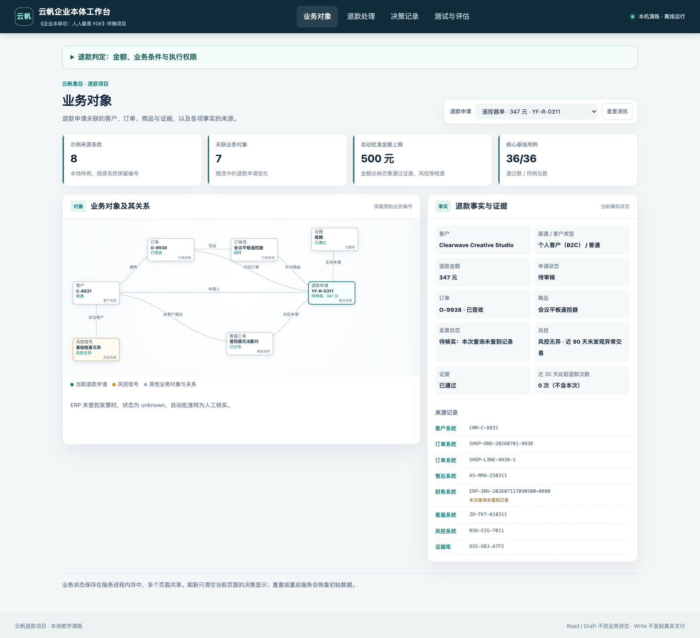
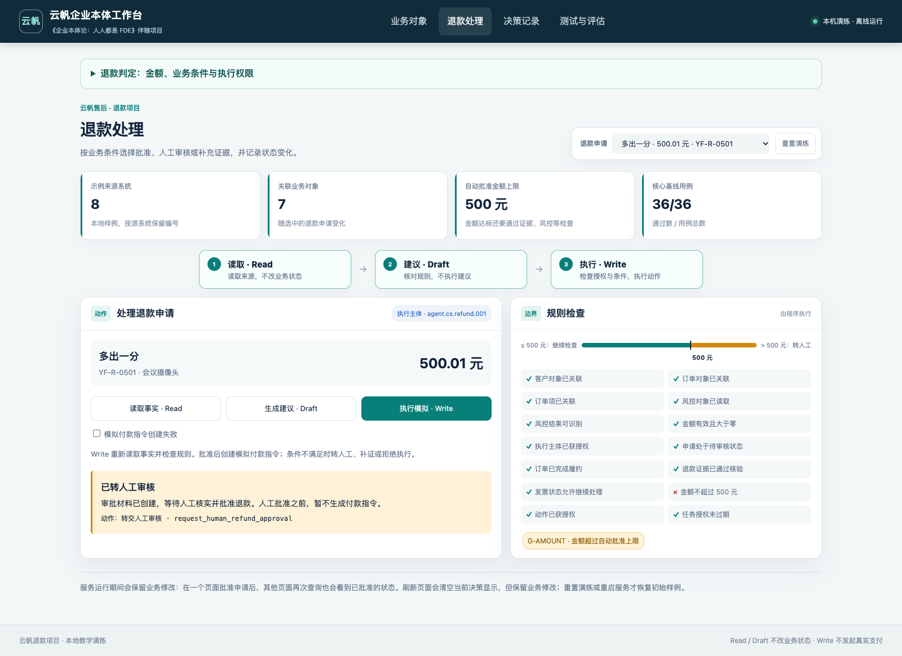
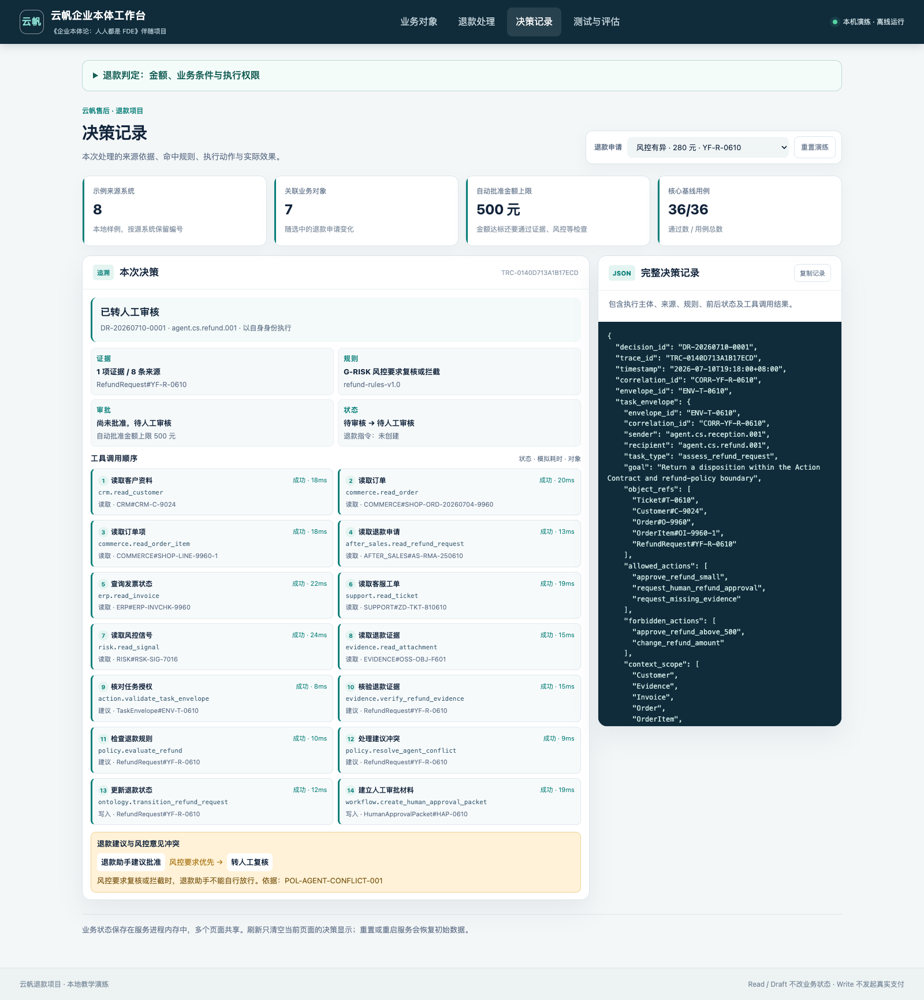
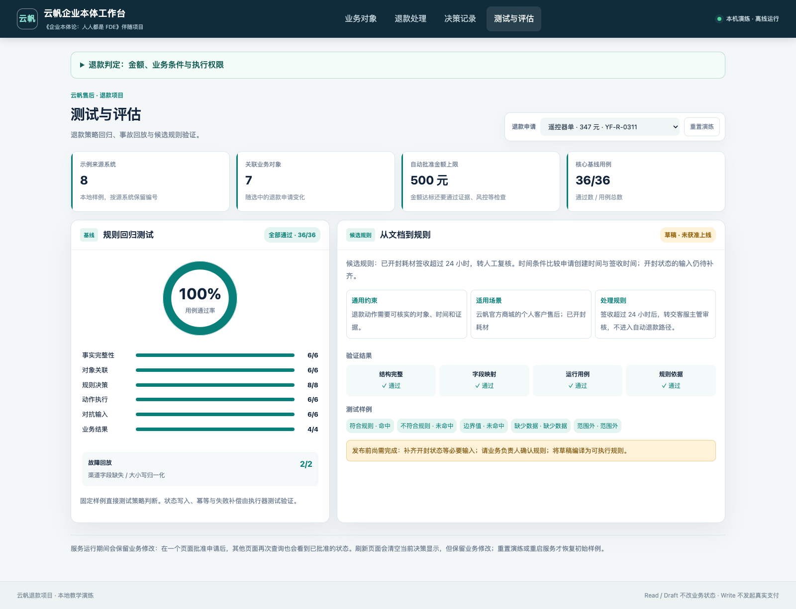

# 企业本体论：人人都是 FDE

<a href="https://u.jd.com/5gaL3hM"></a>

[京东购书：《企业本体论：人人都是FDE》](https://u.jd.com/5gaL3hM)

[快速启动](#快速启动) · [随书十站目录](docs/book-map.md) · [FDE 现场练习](docs/fde-playbook.md) · [版本记录](CHANGELOG.md)

## 从一笔退款理解企业本体

客户申请退还 347 元，低于公司规定的 500 元自动审批上限。客服 Agent 查了订单和发票，ERP 返回 `not_found`。此时能批准退款吗？

云帆案例的退款规则要求：已开票的订单先由财务处理冲红，之后才允许自动创建付款指令。没有查到发票，可能是尚未开票，也可能是记录没有同步。程序把发票状态记为 `unknown`，转交人工核实，避免把可能已开票的订单当作未开票处理。另一笔 500 元的申请，因为发票、风控和证据等条件全部满足，自动批准。

程序需要知道退款对应哪笔订单、哪件商品，发票状态从哪里取得，批准前检查哪些条件。**企业本体定义这些业务对象、关系、状态和动作的含义，使人、Agent 与业务程序能够使用同一套定义。**

本仓库提供书中“云帆退款项目”的可运行实现。可以查看一笔申请如何从原始记录得到处理建议，怎样通过授权与规则检查，再观察付款失败时状态如何变化。

FDE（Forward-Deployed Engineer，前沿部署工程师）参与的正是这类工作：和财务确认“查不到”的处理办法，与系统负责人确定字段来源，把约定实现为规则和测试，并安排异常发生后的接手流程。

## 快速启动

Python 3.11+，仅使用标准库。本地样例数据，离线运行。

```bash
git clone https://github.com/huangjia2019/ontology-fde.git
cd ontology-fde
python3 run.py serve --port 8000
```

访问 http://127.0.0.1:8000 。

Windows 使用 `py -3 run.py serve --port 8000`。下文命令中的 `python3` 也可替换为 `py -3`。

## 业务事实与执行结果

工作台包含业务对象、退款处理、决策记录、测试与评估四个视图，默认申请为“遥控器单” `YF-R-0311`。



这笔申请金额为 347 元。ERP 查询返回 `not_found`，发票状态为 `unknown`，以 Write 模式执行后转人工审核。在人工核实发票并批准退款之前，暂不生成付款指令。业务经过见[遥控器单](docs/artifacts/01-field-walkthrough.md)。

Read 返回业务事实。Draft 返回处理建议，申请仍处于 `pending_review`。Write 会重新读取事实、核验权限并执行动作：这笔申请转为 `pending_human`，同时创建人工审批材料。

### 五笔退款申请

| 短名 | 申请编号 | 金额 | 执行结果 |
|---|---|---:|---|
| 遥控器单 | YF-R-0311 | 347 元 | 发票状态未知，转人工 |
| 刚好五百 | YF-R-0500 | 500 元 | 全部条件满足，批准并生成模拟付款指令 |
| 多出一分 | YF-R-0501 | 500.01 元 | 超过自动批准上限，转人工 |
| 小额黑名单 | YF-R-0312 | 199 元 | 黑名单客户（R3），风控要求拦截（G-RISK），转人工 |
| 合同优先 | YF-R-0415 | 480 元 | 合同客户（R5）且已开票（R2），转人工核对合同和发票 |

自动批准要求金额不超过 500 元，且其他条件全部满足。`approved` 表示申请已批准，付款指令 `created` 表示指令已建立。真实业务还要取得支付结果，才能确认资金是否到账；本地样例模拟到指令创建这一步。



## 本体怎样进入程序

| 站点 | 内容 |
|---|---|
| [1. 确定业务范围](docs/artifacts/01-ontology-positioning-card.md) | 业务目标、对象、来源与自动化范围 |
| [2. 审视原有方案](docs/artifacts/02-historical-audit.md) | 从辅助建议到执行操作的风险审计 |
| [3. 登记执行主体](docs/artifacts/03-identity-acceptance.md) | Agent 身份、归属与生命周期 |
| [4. 建立最小本体](docs/artifacts/04-minimum-ontology.md) | 对象、关系、状态与来源映射 |
| [5. 限定业务动作](docs/artifacts/05-action-contract.md) | 动作契约、幂等与补偿 |
| [6. 整理判断依据](docs/artifacts/06-rule-assets.md) | 规则来源、适用范围与草稿审核 |
| [7. 验证权限](docs/artifacts/07-identity-and-permissions.md) | 身份登记、授权配置与拒绝测试 |
| [8. 处理协作分歧](docs/artifacts/08-multi-agent-coordination.md) | 任务委托、冲突裁决与人工交接 |
| [9. 评估和复盘](docs/artifacts/09-evaluation-audit-and-incident-replay.md) | 决策记录、策略评估与事故回放 |
| [10. 运行交接](docs/artifacts/10-operations-handoff-and-replication.md) | 运行维护、移交与退出检查 |

第 4 站的检查确认五份文件存在、对象目录声明了 `RefundRequest`，以及状态机包含 `approved → approval_pending_payment` 这条补偿转换：

```bash
python3 run.py checkpoint 4 --check
```

协作冲突与故障补偿：

```bash
# 风控否决自动批准，转人工复核
python3 run.py run YF-R-0610 --mode write

# 模拟付款指令创建失败
python3 run.py run YF-R-0800 --mode write --simulate-payment-failure
```

付款指令创建失败后，申请进入 `approval_pending_payment`（已批准、待付款），并生成财务任务 FMT-0800，交财务核查付款故障。程序保留已经完成的批准记录。



## 命令行与源码

```bash
python3 run.py inspect YF-R-0311
python3 run.py run YF-R-0311 --mode draft
python3 run.py run YF-R-0500 --mode write --audit artifacts/my-first-decision.jsonl
```

每次运行命令，程序都会重新读取样例文件。例如，上一次命令批准了 `YF-R-0500`，修改只存在于当时的内存中；再次运行时，这笔申请仍从待审核开始。这样可以在相同条件下比较不同操作的结果。

想查看批准后的申请，可使用 Web 工作台：服务运行期间会保留修改，点击“重置演练”或重启服务才恢复初始样例。`--audit` 把决策记录追加到文件。同一命令重复运行会产生相同的决策编号和轨迹编号，比较不同轮次时请分别保存文件，详见[状态与审计](docs/architecture.md#本地状态时间与审计)。

| 模块 | 入口 |
|---|---|
| 跨系统对象与来源 | [repository.py](src/ontology_fde/repository.py) |
| 退款规则 | [policy.py](src/ontology_fde/policy.py) |
| 授权、执行、幂等与补偿 | [engine.py](src/ontology_fde/engine.py) |
| 决策记录 | [audit.py](src/ontology_fde/audit.py) |
| 对象与动作定义 | [本体配置](config/ontology/)与[动作契约](config/actions/) |
| 测试与评估 | [测试](tests/)与[评估样例](config/evals/) |

`.yaml` 文件按 JSON 格式书写，由标准库 `json` 读取。金额上限等参数从配置读取，时限和发票等判断写在 Python 代码中；各文件的用途见[架构说明](docs/architecture.md)。

## 测试与评估

```bash
python3 tools/verify.py
```

检查范围：文档与截图、单元及集成测试、36 个策略样例、2 个事故回放、十站检查卡及退出资料检查（`exit-drill`）。失败返回非零退出码。

策略评估检查“给定这些事实，应作何决定”；引擎测试检查“决定执行以后，状态、付款指令和审计记录是否正确”。测试分组见[测试口径](docs/release-baseline.md)。



导出评估报告：

```bash
python3 run.py evaluate --output artifacts/evaluation-report.json
```

## 问题反馈

请在 [Issues](https://github.com/huangjia2019/ontology-fde/issues) 提供环境、复现命令及预期与实际结果，勿上传密钥或客户数据。
