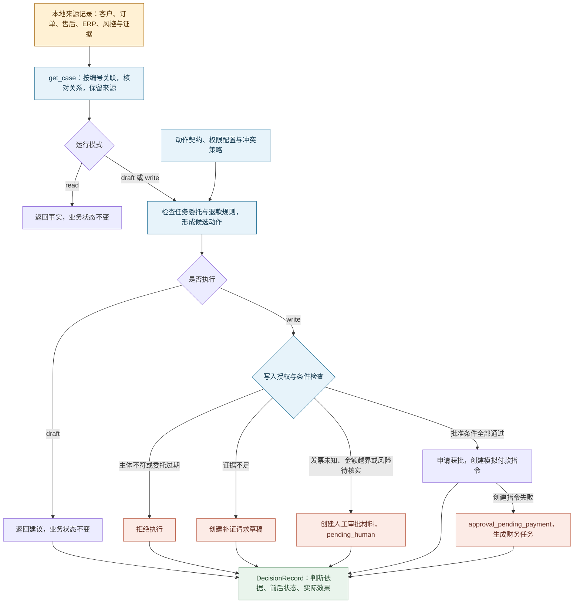

# 云帆退款助手：事实怎样进入一次受控动作

客服收到一笔 347 元的退款申请。程序能找到客户、订单、商品、工单、风控和视频证据，但 ERP 查询没有返回发票记录。按云帆的 R2 规则，已开票订单须先处理冲红再自动创建付款指令。当前无法确认是否开票，因此转人工核实。

这是离线参考实现：没有大模型调用，没有远程 CRM、ERP 或支付接口。样例数据读入内存，规则和动作由 Python 程序执行。图中的系统名表示样例的来源角色。

## 本体解决哪些问题

本项目只建模退款所需的业务范围：谁申请、退哪个商品、依据来自哪里、允许怎样改变状态、失败后留下什么待办。

| 资产 | 文件 | 定义内容 | 程序怎样使用 |
|---|---|---|---|
| 对象目录 | [objects.yaml](../config/ontology/objects.yaml) | 六种核心对象与三种辅助对象 | 规则草稿校验读取它，核对绑定的对象和字段 |
| 关系定义 | [relationships.yaml](../config/ontology/relationships.yaml) | 客户、订单、申请、证据的关系 | 供人核对；数据关联由 `get_case()` 中的代码实现 |
| 状态机 | [state_machines.yaml](../config/ontology/state_machines.yaml) | 退款状态及允许的转换 | `transition()` 读取它，拒绝非法状态跳转 |
| 术语表 | [glossary.yaml](../config/ontology/glossary.yaml) | 申请、批准、补偿、付款指令等含义 | 供人阅读，程序不读取 |
| 来源映射 | [source_map.yaml](../config/ontology/source_map.yaml) | 字段来源、未知值含义与新鲜度要求 | 供人核对；来源选择与未知值处理写在 `get_case()` 中 |

`EnterpriseRepository.get_case()` 按编号和外键关联样例记录；`graph()` 再从这些记录生成节点与边。关系类型是人定义的，当前有哪些对象及连线由数据决定。新增付款指令后，图上才会出现对应的付款对象。ERP 查无记录时，保存的是一次未找到记录的查询结果，订单的发票状态为 `unknown`。取得实际发票记录后，才有对应的发票对象。

来源映射中的新鲜度 SLA 是设计要求。本地程序没有持续刷新各来源，也没有实现所有字段的超时拦截。接入企业系统时，需要补上实际观测时间、刷新机制和过期处理。

## Read、Draft、Write 分别会发生什么

| 模式 | 返回内容 | 业务状态与副作用 |
|---|---|---|
| `read` | 关联后的事实与来源 | 不改变业务对象 |
| `draft` | 候选动作、规则命中、检查结果和决策记录 | 生成 `outcome: drafted` 的记录，申请维持原状态；Write 才会执行批准或创建待办等动作 |
| `write` | 执行结果与决策记录 | 经检查后，在内存中创建待办、推进状态或创建模拟付款指令 |

`write` 在一次调用中完成事实读取、判断和动作执行。`YF-R-0500` 各项条件均通过，批准并创建模拟付款指令；`YF-R-0501` 的 500.01 元超过上限，命中 `G-AMOUNT` 转人工。发票、证据、渠道、履约和风控也参与判断。

主要入口是 [engine.py](../src/ontology_fde/engine.py)。审批成功后的退款状态为 `approved`；付款指令状态为 `created`，表示已经建立指令，后续还需要支付系统执行并返回结果。创建指令失败会保留失败记录，将退款转入 `approval_pending_payment`，并生成财务任务。

## 规则配置与 Python 程序的分工

[policy.py](../src/ontology_fde/policy.py)读取金额上限、契约允许的主体、策略编号和冲突优先级；退款专用的条件判断写在 `evaluate()` 中。`.yaml` 文件使用 JSON 子集，便于标准库直接读取。

退款时限等条件由 Python 代码判断。若政策从“24 小时”改成“48 小时”，需要修改实际比较时间差的代码，再用 48 小时整及超出 48 小时的样例验证。只改 `refund_rules.yaml` 中 R1 的 `when` 表达式，程序仍按 24 小时判断，因为 `policy.py` 只从这份文件读取 `version`。

[规则草稿演示](artifacts/06-rule-assets.md)采用固定样例、模板和确定性提取逻辑，记录规则来源、校验输入并检查审核条件。退款策略继续执行现有规则；采用新草稿前，还要确定商品“已开封”由谁提供、用什么材料核实，完成业务审核并把规则接入 `policy.py`。

## 多 Agent 协作如何呈现

`YF-R-0610` 的金额为 280 元。一般退款条件已通过，但风控发现同一设备短时间内发起多笔售后申请，要求复核。当前实现按[冲突策略](../config/policies/conflict_resolution.yaml)选择 `RiskAgent:review`，保留两个候选意见，并创建人工审批材料。

程序使用登记的角色、任务信封和确定性裁决来呈现协作，没有启动三个独立大模型进程。任务信封记录对象范围、收件人、允许动作和到期时间；执行器会拒绝主体不匹配或过期的写入。

## 本地状态、时间与审计

命令行程序启动时从 `data/mock/` 读取样例，处理过程中修改内存里的对象，退出时这些内存数据随之释放。样例文件保持原样。因此，先运行一次批准 `YF-R-0500` 的命令，再单独查询它，会看到原来的待审核状态。这样的运行方式便于重复比较规则和授权条件。

Web 服务会持续运行，在内存中保留已修改的申请、付款指令和幂等记录。同一服务下的页面再次查询时能够看到这些修改；重置或重启服务才恢复初始数据。同一执行者在同一引擎实例中重复提交相同 `intent_id`，会得到原决策和 `idempotent_replay: true`，避免重复创建指令，见[幂等测试](../tests/test_engine.py)。

`--audit` 将每次决策追加到 JSONL 文件。同一命令重新启动运行时，决策编号从头生成，默认时间仍取申请时间，`trace_id` 也按相同输入计算，因此三个字段可能完全重复。文件中没有运行批次字段。比较不同轮次时，每轮使用不同的文件名，并另外记下代码与配置版本。

程序启动时仍从样例文件读取业务对象。JSONL 供事后查看，有写权限的人可以修改；用于正式审计时，还要配置访问控制和防篡改存储。

任务信封在申请提交 4 小时后过期。默认处理时间取申请时间，使这些固定历史样例能够执行。用 `--processing-at` 指定晚于信封期限的时间，写入会因 `G-ENVELOPE-EXPIRED` 被拒绝；以当前时间处理这些样例，也会遇到过期。

样例并非按当时可见数据重建的历史快照。例如，遥控器单的默认处理时间为 7 月 10 日 18:40:12，ERP 查询快照时间却是 7 月 11 日 09:05，两者均为 UTC+8。程序尚未检查这种时间矛盾。做真实历史回放时，应只使用当时已取得的记录，并验证来源时间。

轨迹中的 `duration_ms` 是程序生成的模拟值，用于展示耗时字段。测量真实性能需要在实际调用前后计时。

## 接入企业系统前还缺什么

| 当前实现 | 企业项目需要落实的工作 |
|---|---|
| 本地 JSON 与编号映射 | 经授权的只读连接器，字段责任、新鲜度与脱敏 |
| 内存对象与幂等表 | 业务 API、持久化幂等、并发控制、事务与对账 |
| `agent_id` 字符串与权限配置 | 工作负载身份验证、凭据管理、字段权限、授权期限和环境隔离 |
| 模拟人工审批材料 | 实际审批队列、接收人、超时升级与处理回执 |
| JSONL 决策记录 | 企业审计保存、访问控制、防篡改与检索 |
| 离线退出检查 | 各系统实际停用写入、撤销凭据、迁移待办与验证业务连续性 |

六维权限中，程序会检查动作允许和禁止清单，以及退款业务条件。数据对象范围、工具清单、配置中的授权时间窗和环境限制尚未用于拦截；其中部分值只附在任务或决策记录中。任务信封的四小时期限另有执行检查，详见[权限验收卡](artifacts/07-identity-and-permissions.md)。

继续阅读：[十站目录](book-map.md) · [架构图源文件](assets/architecture/yunfan-ontology-agent-system-evolution.mmd) · [测试口径](release-baseline.md)
